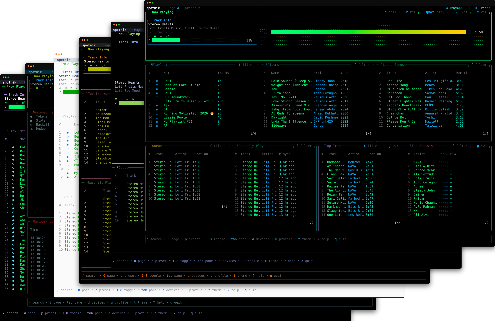

<p align="center">
  <a href="https://github.com/initgrep-apps/spotnik/actions/workflows/ci.yml"></a>
  <a href="https://github.com/initgrep-apps/spotnik/releases/latest"></a>
  <a href="go.mod"></a>
  <a href="LICENSE"></a>
  <a href="#install"></a>
</p>

<h1 align="center">Spotnik</h1>

<p align="center">
  Keyboard-driven Spotify client for the terminal.
  <br>
  One Go binary. Controls Spotify Connect devices. Does not stream audio.
</p>



Spotnik is a TUI for people who live in a shell. It browses your library,
searches Spotify, and drives playback on your Connect devices without leaving
the terminal.

**Spotify Premium is required.** The Web API only allows playback control on
Premium accounts. Spotnik itself plays no audio.

## Features

| | |
|---|---|
| **Keyboard-first TUI** | Panes, presets, overlays, and filters. Mouse wheel scrolling works too. |
| **Playback control** | Play, pause, seek, skip, volume, shuffle, repeat, and device transfer. |
| **Library browsing** | Playlists, albums, liked songs, recently played, top tracks, and top artists. |
| **Search** | Full-screen search across songs, artists, albums, playlists, shows, and episodes. |
| **Podcasts** | Followed shows, saved episodes, and episode details on the Player page. |
| **Live API stats** | Gateway health, polling traffic, in-flight requests, and a network log. |
| **13 themes** | Runtime switcher, TOML-defined, with mono and light variants. |
| **Single binary** | Go, no runtime dependencies, native installers for three platforms. |

The Player page holds music and podcast panes: Now Playing, Queue, Playlists,
Albums, Liked Songs, Recently Played, Top Tracks, Top Artists, Followed Shows,
and Saved Episodes. `p` cycles six presets. The Stats page shows the developer
view of the API gateway.

## Install

### macOS and Linux

```bash
curl -fsSL https://raw.githubusercontent.com/initgrep-apps/spotnik/main/install.sh | bash
```

Pin a version with `SPOTNIK_VERSION`:

```bash
curl -fsSL https://raw.githubusercontent.com/initgrep-apps/spotnik/main/install.sh | SPOTNIK_VERSION=v0.1.1 bash
```

### Windows

```powershell
irm https://raw.githubusercontent.com/initgrep-apps/spotnik/main/install.ps1 | iex
```

Pin a version in PowerShell:

```powershell
$env:SPOTNIK_VERSION="v0.1.1"; irm https://raw.githubusercontent.com/initgrep-apps/spotnik/main/install.ps1 | iex
```

The installers add `spotnik` to your user PATH and write
`~/.config/spotnik/env`. Open a new terminal, or run
`. ~/.config/spotnik/env` in the current shell.

### Other

DEB and RPM packages, archives, and checksums are on the
[Releases page](https://github.com/initgrep-apps/spotnik/releases/latest). You
can also build from source:

```bash
go install github.com/initgrep-apps/spotnik@latest
```

## Setup

A Spotify Developer app is needed for the PKCE OAuth flow:

1. Create an app at [developer.spotify.com/dashboard](https://developer.spotify.com/dashboard).
2. Add `http://127.0.0.1:8888/callback` as a redirect URI.
3. Run `spotnik`. It bootstraps `~/.config/spotnik/config.toml` and asks for the
   Client ID on first launch.
4. Authorize in the browser. Tokens go to the OS keychain.

Spotnik requests 14 OAuth scopes. See [`docs/SCOPES.md`](docs/SCOPES.md) for the
full list and how to revoke access.

## Usage

Start with `spotnik`. Press `0` to switch between Player and Stats, `p` to cycle
Player presets, `Tab` to move focus, and `?` for the in-app keybinding overlay.
Playback keys work from any pane: `Space`, `←`/`→`, `Shift+←`/`Shift+→`, `+`,
`-`, `s`, `r`, and `v`.

### Keybindings

#### Global

| Key | Action |
|---|---|
| `/` | Search overlay |
| `d` | Device switcher |
| `u` | User profile overlay |
| `t` | Theme switcher |
| `?` | Help overlay |
| `q` | Quit |
| `0` | Cycle Player / Stats |
| `1`–`8` | Toggle pane visibility (Player page) |
| `1`–`5` | Toggle pane visibility (Stats page) |
| `p` | Cycle preset on Player page |

#### Playback

| Key | Action |
|---|---|
| `Space` | Play / pause |
| `←` / `→` | Seek back / forward 5 s |
| `Shift+←` / `Shift+→` | Previous / next track |
| `+` / `-` | Volume |
| `s` | Toggle shuffle |
| `r` | Cycle repeat |
| `v` | Cycle visualizer pattern |
| `i` | Episode details (when an episode is playing) |

#### Navigation

| Key | Action |
|---|---|
| `Tab` / `Shift+Tab` | Cycle focus |
| `↑` `↓` `j` `k` | Scroll |
| Mouse wheel | Scroll the pane under the cursor |
| `Esc` | Close overlay, clear filter, or scroll to top |

#### Pane actions

| Key | Action | Context |
|---|---|---|
| `Enter` | Select or play | Focused pane |
| `f` | Toggle filter | List panes |
| `g` | Cycle time range | Top Tracks, Top Artists |
| `l` | Like / unlike track | Now Playing, Liked Songs, Queue, Top Tracks, Recently Played, Playlists, Albums, Search |

#### Search overlay

| Key | Action |
|---|---|
| `Tab` / `Shift+Tab` | Cycle category |
| `Enter` | Play result |
| `Ctrl+A` | Add to queue |
| `Ctrl+U` | Clear input |
| `PgDn` / `PgUp` | Page results |
| `Esc` | Close |

#### Profile overlay

| Key | Action |
|---|---|
| `l` | Logout. Press twice to confirm. Keeps the Client ID. |
| `f` | Forget. Press twice to confirm. Also removes the Client ID. |

## Configuration

Spotnik bootstraps `~/.config/spotnik/config.toml` on first launch.

```toml
[spotify]
# client_id = "your-client-id-from-spotify-developer-dashboard"

[preferences]
theme = "black"
# preset = 0          # Player layout preset index (0-based)
# visualizer = 0      # Visualizer pattern index (0-6)

[cli]
# "auto" (default), "fixed", or "theme"
palette = "auto"

[ui]
# "auto" (default), "unicode", or "ascii"
glyphs = "auto"
```

Themes: `black` (default), `monokai`, `catppuccin`, `nord`, `light`, `dracula`,
`gruvbox`, `rosepine`, `solarized`, `synthwave`, `tokyonight`, `mono-dark`,
`mono-light`.

`palette = "auto"` uses theme colours on dark terminals and the fixed Spotnik
palette elsewhere. `glyphs = "auto"` chooses Unicode when the locale is UTF-8
and ASCII otherwise.

## Uninstall

```bash
curl -fsSL https://raw.githubusercontent.com/initgrep-apps/spotnik/main/uninstall.sh | bash
```

On Windows:

```powershell
irm https://raw.githubusercontent.com/initgrep-apps/spotnik/main/uninstall.ps1 | iex
```

Both remove the binary, PATH integration, and env file, wipe tokens with
`spotnik auth forget`, and ask before deleting `~/.config/spotnik`. Set
`SPOTNIK_PURGE_CONFIG=1` to skip the prompt and delete the config, or
`SPOTNIK_KEEP_CONFIG=1` to keep it.

Manual removal:

```bash
spotnik auth forget
sudo rm "$(command -v spotnik)"
rm -rf ~/.config/spotnik
```

## Development

Requires **Go 1.26+** and **golangci-lint**.

```bash
git clone https://github.com/initgrep-apps/spotnik.git
cd spotnik
make ci          # fmt, tidy, lint, tests, 80% coverage, glyph guards, build
make run         # build and run
```

Run `make ci` before every PR. See [`CONTRIBUTING.md`](CONTRIBUTING.md) for the
branch, spec, and testing workflow.

Architecture and system docs live in [`docs/system/`](docs/system/):
[`architecture.md`](docs/system/architecture.md),
[`design.md`](docs/system/design.md),
[`cli.md`](docs/system/cli.md),
[`tui.md`](docs/system/tui.md), and
[`api-guide.md`](docs/system/api-guide.md).

Built with [Go](https://go.dev), [Bubble Tea](https://github.com/charmbracelet/bubbletea),
[Lip Gloss](https://github.com/charmbracelet/lipgloss), and
[Bubbles](https://github.com/charmbracelet/bubbles). Releases use
[GoReleaser](https://goreleaser.com) and
[release-please](https://github.com/googleapis/release-please).

## Security

Spotnik stores OAuth tokens in the OS keychain and runs the OAuth callback on
`127.0.0.1`. To report a vulnerability, use
[GitHub private vulnerability reporting](https://github.com/initgrep-apps/spotnik/security/advisories/new)
as described in [`SECURITY.md`](SECURITY.md). Do not open a public issue.

## License

MIT. See [LICENSE](LICENSE).

Changes are listed in [CHANGELOG.md](CHANGELOG.md).
